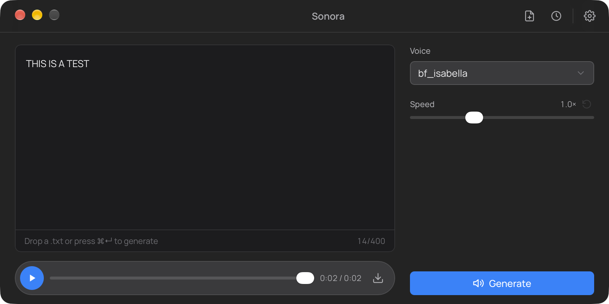

<p align="center"></p>
<h1 align="center">Sonora</h1>

<p align="center">
  
  
  
  
  
  
  
  
</p>

<p align="center">
  
  <br>
  <sub><b>Main window</b></sub>
</p>

Sonora is a native, **fully offline** text-to-speech desktop app. Type or drop in text, pick one of 55 voices, and generate speech locally — powered by the [Kokoro-82M](https://huggingface.co/onnx-community/Kokoro-82M-v1.0-ONNX) model running **in-process** via ONNX Runtime. No Python, no server, no network.

## Features

- **Offline by design** — the model runs inside the app (Rust + `kokoro-en`); nothing leaves your machine.
- **55 voices** with a searchable, keyboard-navigable picker.
- **Adjustable speed** (0.5–2.0×) with a one-click reset.
- **Type, paste, or drop a `.txt`** to load text.
- **History** — every generation is saved; replay, re-use, download, or delete.
- **Settings** — default voice, speed, audio format, and save location.
- **Native system chrome** — unified toolbar, system light/dark, and macOS traffic lights.

## Download (macOS)

Grab the latest **`Sonora-macos.zip`** from the [**Releases**](../../releases/latest) page and unzip it.

> The build is **arm64-only** — it runs on Apple Silicon Macs, not Intel.

### ⚠️ Unsigned & not notarized

Builds are **ad-hoc signed only** — they are **not** notarized by Apple, so Gatekeeper will refuse to open a downloaded copy ("…cannot be opened because the developer cannot be verified", or "…is damaged and can't be opened"). To allow it, open **System Settings → Privacy & Security** and click **Open Anyway** next to the blocked-app notice.

## Download (Linux)

Grab the latest **`.AppImage`**, **`.deb`**, or **`.rpm`** from the [**Releases**](../../releases/latest) page.

> The builds are **x86_64-only**.

**AppImage** (portable, no installation):

```sh
chmod +x Sonora_*.AppImage
./Sonora_*.AppImage
```

**Debian / Ubuntu**:

```sh
sudo apt install ./Sonora_*.deb
```

**Fedora / RHEL**:

```sh
sudo dnf install ./Sonora-*.rpm
```

### Runtime requirements

Linux builds render with **WebKitGTK 4.1** and play audio through **GStreamer**, so the host needs:

- **glibc 2.38 or newer** — Ubuntu 24.04+, Debian 13+, Fedora 39+, RHEL 10+ (required by the bundled ONNX Runtime)
- `libwebkit2gtk-4.1-0` — the AppImage is *not* fully self-contained and still requires this
- `libgtk-3-0`
- `gstreamer1.0-plugins-base` and `gstreamer1.0-plugins-good` (WAV playback)

The `.deb` declares these as dependencies; install them yourself for the AppImage or `.rpm` if your distribution doesn't pull them in.

> ⚠️ **Unsigned** — Linux packages aren't code-signed, so your package manager may warn about an untrusted package.

## Model setup

The TTS model and voice files are **not** committed (they're gitignored). Fetch them once:

```sh
./scripts/download-models.sh
```

This downloads `model.onnx` (~325 MB, fp32) and all 55 voice packs from Hugging Face into `src-tauri/resources/`.

## Development

Prerequisites: **Rust**, **Bun**, and **CMake** (espeak-ng is compiled from source during the build).

- **macOS**: the Xcode Command Line Tools.
- **Linux** (build on **Ubuntu 24.04 or newer** — see below): `libwebkit2gtk-4.1-dev build-essential curl wget file libxdo-dev libssl-dev libayatana-appindicator3-dev librsvg2-dev patchelf cmake`, plus the FUSE 2 runtime (`libfuse2t64` on 24.04) for AppImage bundling.

> The Linux build links a prebuilt ONNX Runtime that requires **glibc ≥ 2.38** and **libstdc++ ≥ GCC 12**, so it must be built on Ubuntu 24.04+.

```sh
bun install
./scripts/download-models.sh   # first run only
bun tauri dev
```

Build release bundles:

```sh
# macOS
bun tauri build --bundles app
# → src-tauri/target/release/bundle/macos/Sonora.app

# Linux
bun tauri build --bundles deb,rpm,appimage
# → src-tauri/target/release/bundle/{appimage,deb,rpm}/
```

See [`AGENTS.md`](AGENTS.md) for architecture, Tauri commands, and conventions.

## License

[MIT](LICENSE)

Bundled model weights and voices come from
[Kokoro-82M](https://huggingface.co/onnx-community/Kokoro-82M-v1.0-ONNX), licensed
[Apache-2.0](https://www.apache.org/licenses/LICENSE-2.0).
